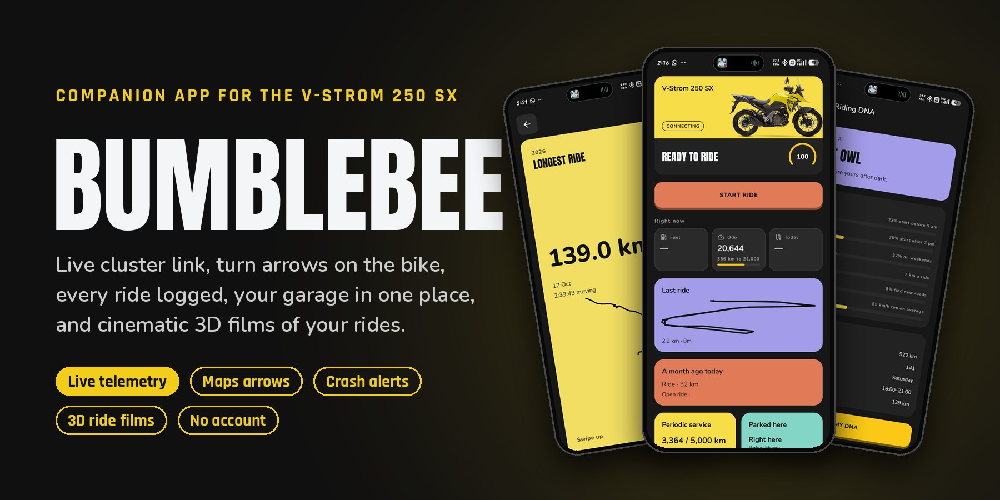
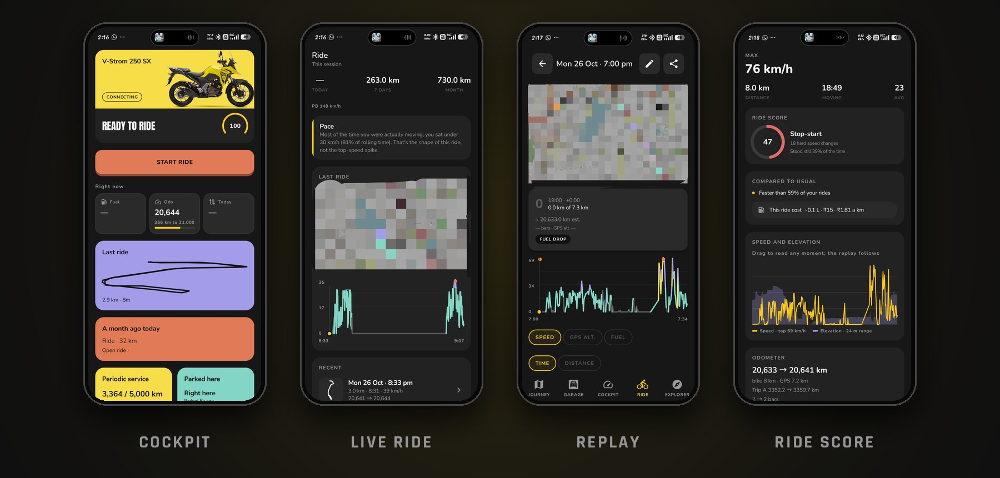
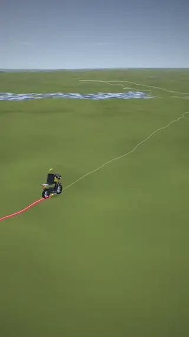
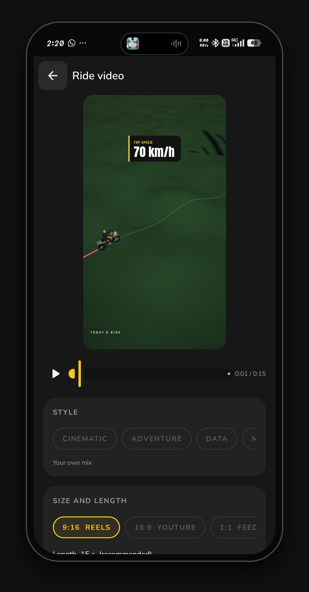
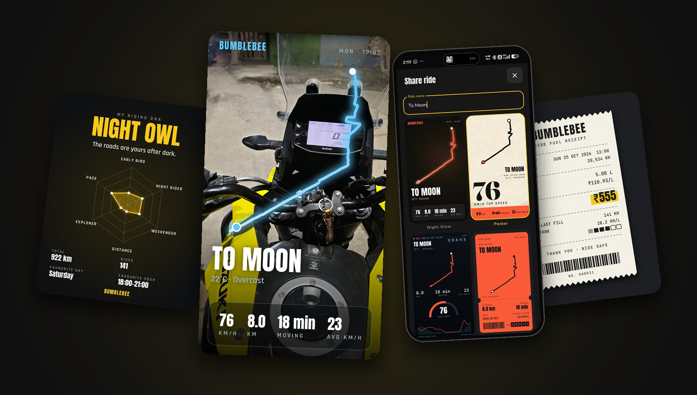
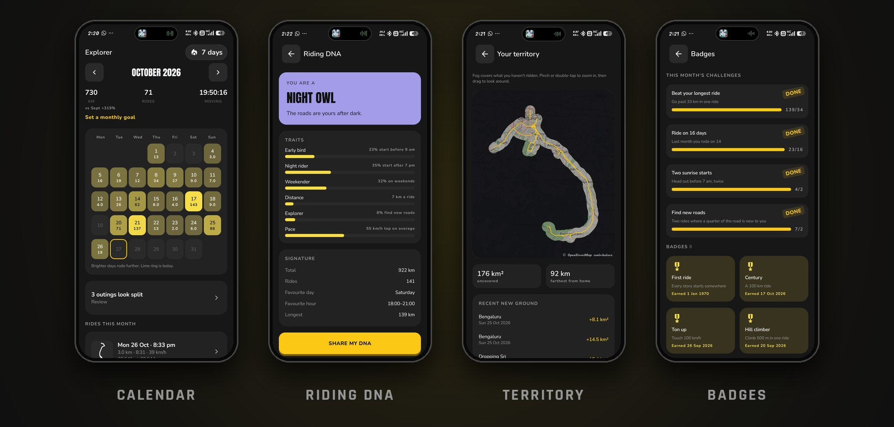
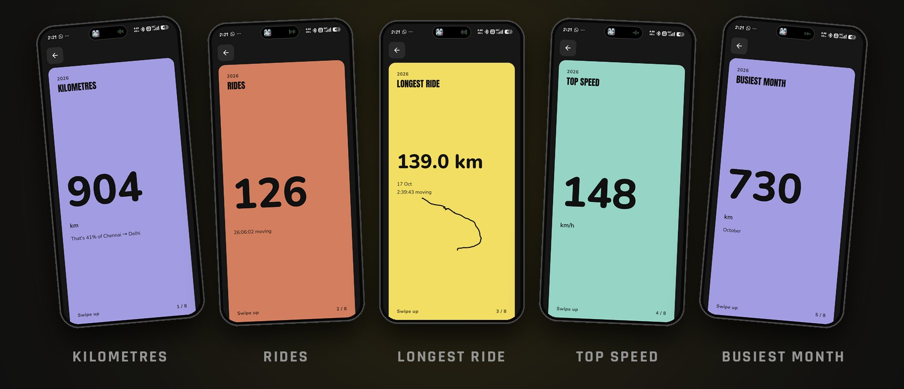
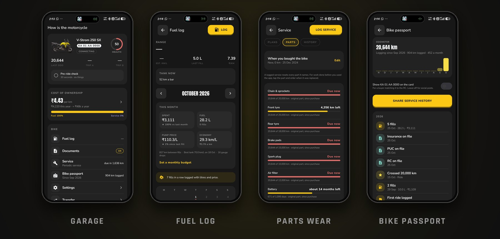
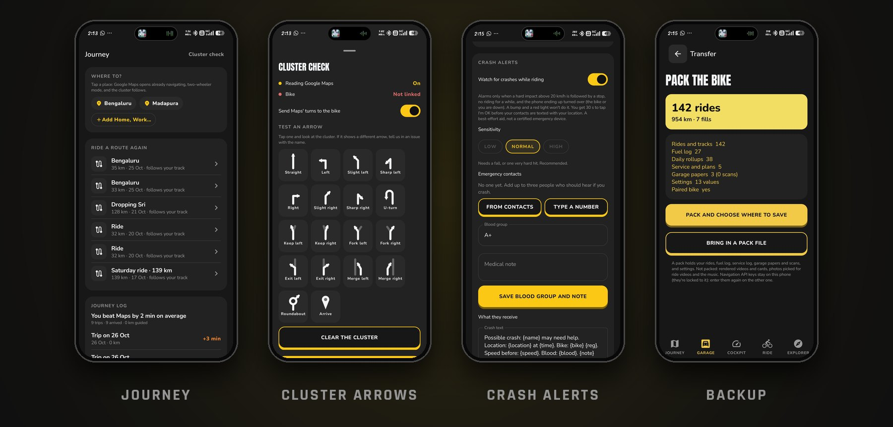

<p align="center">
  
</p>

<p align="center">
  <a href="https://github.com/dineshgdk07/VstromDash/releases/latest"></a>
  <a href="https://github.com/dineshgdk07/VstromDash/actions/workflows/ci.yml"></a>
  
  
  
</p>

<p align="center">
  <a href="https://github.com/dineshgdk07/VstromDash/releases/latest"><b>Download the APK</b></a> ·
  <a href="docs/INSTALL.md">Install guide</a> ·
  <a href="#ride-films">Ride films</a> ·
  <a href="#privacy">Privacy</a> ·
  <a href="#build">Build</a>
</p>

**Bumblebee** is an unofficial, local-first companion app for the **Suzuki V-Strom 250 SX**. It
links to the bike's Bluetooth instrument cluster for live telemetry, puts Google Maps' turn arrows
on the bike's own display, logs every ride, fill and service, and turns your rides into share
cards and cinematic 3D films. No account, no server, no tracking: it all stays on your phone.

> **Not affiliated with Suzuki.** "Suzuki", "V-Strom" and "Suzuki Ride Connect" are trademarks of
> Suzuki Motor Corporation. A hobby project, not a certified safety device. See [Disclaimer](#disclaimer).

| | | |
| :--- | :--- | :--- |
| 🏍️ **Live cluster link**<br>Speed, odometer, trips, fuel bars and economy, straight from the bike | 🧭 **Arrows on the bike**<br>Google Maps' turns on the cluster, no key needed, or the app's own navigation | 🚨 **Crash alerts**<br>An "I'm OK" countdown, then SMS with your location, retried until it's sent |
| 📈 **Every ride, replayed**<br>Splits, ride score, speed and elevation, a replay map and your usual pace | 🧰 **Your garage**<br>Fuel log, service plans, parts wear, papers with expiry reminders, costs | 🎬 **Ride films**<br>3D terrain flyovers of your rides with your bike, photos and music |

## On the ride

<p align="center"></p>

**Cockpit** checks you're ready (fuel, weather, link, service), then the **live ride** shows splits,
fuel ahead, break nudges and a ghost of your usual pace. Afterwards every ride gets a **replay**,
a speed and elevation chart and a **ride score** that explains itself.

## Ride films

<table>
  <tr>
    <td width="44%" align="center">
      <br>
      <sub>A real export, made on the phone. <a href="screenshots/Ride%20Detail%20-%20Export%20-%20Video%20-%20Sample.mp4">Full-quality MP4</a></sub>
    </td>
    <td width="56%">
      <b>Your ride as a short film, rendered on the phone.</b>
      <ul>
        <li>Real terrain in 3D, lit by the sun at the time you rode, with clouds, lakes and town names</li>
        <li>A 3D V-Strom in your paint that leans into bends at your real speed</li>
        <li>A camera that dives in, chases the road, circles highlights and pulls back to reveal the route</li>
        <li>The trail coloured by speed or gradient; chapters, milestones and live stats</li>
        <li>Your photos from the ride as postcards where you took them</li>
        <li>Your own music, with the cuts landing on the beat</li>
        <li>9:16, 16:9 or 1:1, and every part of it adjustable in the Studio</li>
      </ul>
      
    </td>
  </tr>
</table>

## Share cards

<p align="center"></p>

Four card designs on a map, your own photo (move and zoom it), or a transparent sticker for
Instagram stories. Plus a **Riding DNA** card, a **fuel receipt** for every fill, and the year in
review. Every share hides the first and last 500 m of a ride, so it never leads to your door.

## Explore your riding

<p align="center"></p>

A calendar of rides with a monthly goal, personal records, a territory map that clears the fog
where you've been, badges and challenges, ride compare, and your **Riding DNA**.

<p align="center"></p>

## Garage

<p align="center"></p>

A live bike panel and health score, a **fuel log** with real mileage and insights, **service plans**
with forecasts, **parts wear**, cost of ownership, documents with expiry reminders and a checkpost
view, and a **bike passport** to share when you sell.

## Journey and safety

<p align="center"></p>

- **Journey:** tap a place and Google Maps opens already navigating while the arrows go to the bike,
  or use the app's own navigation with your Google or OpenRouteService key. Saved places, a trip log,
  and a big night-and-rain view.
- **Crash alerts:** an "I'm OK" countdown (30 s by default), then an SMS with your location to up to
  three contacts. Each text is followed until the network takes it and retried when there's no signal.
- **Backup:** one file holds your rides, fuel log, service log, papers and settings. Move to a new
  phone with a progress bar and a log of every step.
- **Advanced:** off-route and re-route tuning, a 24-hour cluster clock, crash countdown, map cache,
  clean-up tools, and developer options (tap the version line seven times).

## Privacy

Everything stays on the phone. There is no account, no server and no analytics. The app only goes
online for:

- **Map tiles** from [OpenStreetMap](https://www.openstreetmap.org/copyright) (© OpenStreetMap contributors)
- **Weather** from [Open-Meteo](https://open-meteo.com/)
- **Routing and place search** from Google or [OpenRouteService](https://openrouteservice.org/), only if you
  add your own key and choose that navigation mode
- **SMS** to your own emergency contacts, only after a crash alarm is not cancelled, or when you send a test

Sensitive permissions and why:

| Permission | Used for |
| --- | --- |
| Bluetooth | Linking to the cluster |
| Location | Ride tracks, parked spot, weather, crash alert location |
| Notification access | Reading Google Maps' navigation notification to drive the cluster arrows |
| SMS | Crash alerts to your chosen contacts |
| Full-screen intent | Showing the crash alarm over the lock screen |

## Install

Download the latest APK from [Releases](https://github.com/dineshgdk07/VstromDash/releases) on your
phone. Android 8.0 or newer. Updates install over the previous version and keep your data.

Play Protect blocks the install in India because the app asks for notification access (to read
Google Maps' turns for the cluster arrows). If it does, pause Play Protect scanning while you
install, then turn it back on. On Android 13+, notification access and SMS start locked for a
downloaded app; the app guides you through unlocking them once. The
[install guide](docs/INSTALL.md) covers both.

## Build

Requirements: JDK 17 and the Android SDK (compileSdk 35, minSdk 26).

```bash
./gradlew :app:installDebug        # build and install on a connected phone
./gradlew test                      # JVM unit tests for all modules
```

Release builds are signed only when these environment variables are set; otherwise the APK comes out
unsigned (add `-PdebugSignRelease` to debug-sign one for testing). Never commit keystores or
passwords; `.gitignore` blocks the usual files. Tagged releases are built by CI; see
[docs/RELEASING.md](docs/RELEASING.md).

```bash
export BUMBLEBEE_STORE_FILE=/path/to/release.jks
export BUMBLEBEE_STORE_PASSWORD=...
export BUMBLEBEE_KEY_ALIAS=...
export BUMBLEBEE_KEY_PASSWORD=...
./gradlew :app:assembleRelease
```

<details>
<summary><b>Project layout</b></summary>

| Module | What lives there |
| --- | --- |
| `app` | Jetpack Compose UI, services (Bluetooth bridge, crash alert, reminders), share card rendering |
| `core:protocol` | Cluster frame encoding and decoding. **See [Credits](#credits): not covered by this repo's licence** |
| `core:ble` | Suzuki GATT surface |
| `core:ble-android` | Android Bluetooth client, scanning, preferences |
| `core:nav` | Google Maps notification parsing to cluster arrows |
| `core:ride` | Pure Kotlin ride, fuel, garage and insight logic, with most of the unit tests |
| `core:snapshot` | Backup and restore format |
| `data:local` | Room database and the capture repository |

Design notes live in [`docs/`](docs/).

</details>

## Credits

- **Cluster protocol:** the Bluetooth protocol work, and the code in `core/protocol`, come from
  [mrwick1/suzuki-connect-re](https://github.com/mrwick1/suzuki-connect-re) (REDLINE) by Arjun.
  That project has no licence yet, so `core/protocol` is **not** covered by this repo's MIT licence
  and remains its author's work. Permission has been requested; see [NOTICE.md](NOTICE.md).
- **Map data:** © OpenStreetMap contributors, under the ODbL.
- **Weather:** Open-Meteo.
- **Fonts:** Anton, Fraunces, JetBrains Mono, Nunito, Permanent Marker and Rajdhani, under the SIL
  Open Font License or Apache 2.0 (details in [NOTICE.md](NOTICE.md)).

## Contributing

Issues and pull requests are welcome. Please read [CONTRIBUTING.md](CONTRIBUTING.md) first, and
report security problems privately as described in [SECURITY.md](SECURITY.md).

## Licence

The original code in this repository is under the [MIT Licence](LICENSE), except where
[NOTICE.md](NOTICE.md) says otherwise (notably `core/protocol`, the bike images and the fonts).

## Disclaimer

This app is provided as is, with no warranty. Crash detection is a best-effort aid that can miss a
crash or raise a false alarm; it does not replace emergency services. Don't interact with the phone
while riding. Use of the bike's Bluetooth interface is unofficial and at your own risk.
